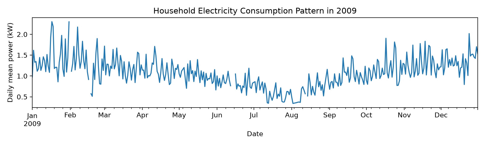
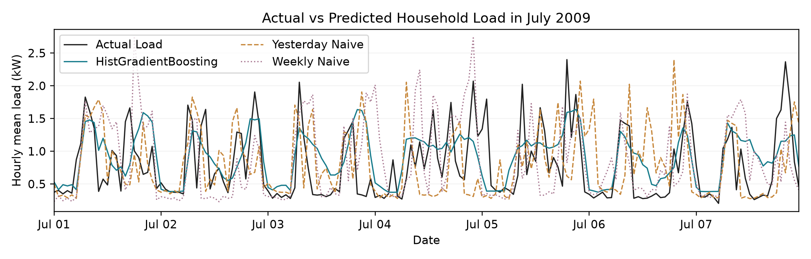
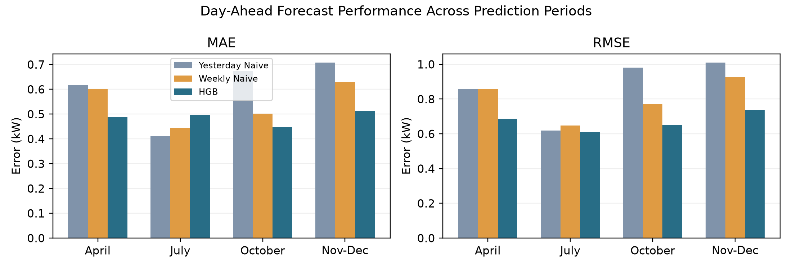

# Evaluating Day-Ahead Household Electricity Load Forecasting Across Different Months Using Expanding Training Windows

## Abstract

This study evaluates day-ahead household load forecasting with HistGradientBoostingRegressor (HGB), Yesterday Naive and Weekly Naive. Expanding training windows are used to predict April, July and October 2009. HGB has the lowest MAE and RMSE in April and October. In July, its MAE is 0.495760 kW, above both baselines, while its RMSE of 0.610989 kW is slightly lower. A July case analysis finds frequent low-load overestimation alongside fewer large absolute errors. Longer training windows do not consistently correspond to lower forecast error across these months.

## 1. Introduction

The UCI household dataset [1] offers a case study of irregular demand at a single home. This study compares HGB [2] with two persistence baselines to ask whether a learned model improves forecasts consistently across months. Calendar and lagged demand variables are established inputs in short-term load forecasting [3]. At household level, errors in the timing of sharp changes can affect pointwise scores [4]. Here, the same MAE and RMSE measures are used throughout, with particular attention to their different July rankings.

## 2. Dataset and Methodology

Global_active_power is minute-average active power in kW. The existing January-December 2009 hourly series is reused. Timestamps are parsed as dd/mm/yyyy and hh:mm:ss and kept as recorded. Invalid and negative readings are missing, duplicate timestamps are averaged, and an hourly mean requires at least 54 valid minutes. Of 8760 hours, 8686 are valid and 74 lack sufficient observations. Targets are not interpolated.

At midnight, the next 24 hours are predicted from target hour, weekday, weekend, month, previous-day and previous-week same-hour loads, and trailing 24-hour and 168-hour means. All load inputs precede the origin. The rolling means are constant within a target day; observations from earlier days in the prediction month become available for later origins. Fitting requires complete features and a valid target. All three methods use identical eligible evaluation timestamps.

Yesterday Naive copies the previous day and Weekly Naive the previous week. HGB uses 150 iterations, 15 maximum leaves, learning rate 0.05, L2 regularization 1.0, seed 42 and disabled early stopping. Predictions are clipped at zero. Parameters are fixed across experiments. MAE averages absolute errors; RMSE places greater weight on large errors. No normal observations are removed on the basis of forecast error.

## 3. Expanding Window Backtesting

Experiment A fits January-March and forecasts April; B fits January-June and forecasts July; C fits January-September and forecasts October. Each model is fitted once before its prediction month. The usable training counts are 1653, 3597 and 5622. Invalid targets account for 3, 59 and 74 excluded training hours; incomplete history excludes another 504, 688 and 856 valid-target hours. All 720 April hours and all 744 hours in July and October are evaluated.

The November-December comparison comes from the earlier independent test: January-August training, September-October validation and January-October final refitting. The additional months are retrospective backtests, not replacement independent tests. Their training lengths and calendar periods change together, preventing separate estimates of a seasonal effect or a benefit from more training data.

## 4. Results and Analysis

Table 1. MAE / RMSE in kW across four evaluation periods.

| Period | Yesterday MAE / RMSE | Weekly MAE / RMSE | HGB MAE / RMSE |
| --- | --- | --- | --- |
| April | 0.617752 / 0.859661 | 0.602425 / 0.858900 | 0.488954 / 0.687920 |
| July | 0.412150 / 0.618943 | 0.443917 / 0.648654 | 0.495760 / 0.610989 |
| October | 0.673703 / 0.980791 | 0.502447 / 0.772568 | 0.447173 / 0.651662 |
| November-December | 0.707789 / 1.009972 | 0.629595 / 0.925265 | 0.512628 / 0.735804 |

HGB improves on both baselines in April and October and also has the lowest errors in the November-December test. Its lowest MAE is in October (0.447173 kW), while its lowest RMSE is in July. In July, HGB MAE is 20.29% higher than Yesterday Naive, but RMSE is 1.29% lower. Neither the training-window length nor a single error measure produces a consistent ranking of forecast quality.

Figure 1. Daily mean household power in 2009. Days without 24 valid hours remain gaps.

July has mean actual load 0.618 kW and median 0.370 kW; its middle half lies between 0.296 and 0.815 kW. Of 744 hours, 503 (67.6%) are below 0.6 kW. HGB predicts 0.935 kW on average, giving mean signed error +0.317 kW. In those low-load hours, it overestimates 491 times, with mean error +0.530 kW. Every July day has a positive mean HGB error within its low-load hours.

Figure 2. July 1-7: the earliest complete seven-day window with 168 common valid hours, selected without using forecast errors.

The July curve is generally too high at low demand and too smooth around peaks. Across the whole month, 72 of the 75 hours at or above the actual-load 90th percentile (1.388 kW) are underestimated, with mean signed error -0.638 kW. The month-wide maximum occurs outside the plotted week, on July 8 at 08:00: actual 3.050 kW, HGB 1.312 kW. The percentile grouping is descriptive and does not change the evaluation sample.

Table 2. July absolute-error distribution and sum of squared errors (SSE).

| Method | Median AE (kW) | Hours AE > 1 kW | Max AE (kW) | SSE (kW²) |
| --- | --- | --- | --- | --- |
| Yesterday Naive | 0.192 | 101 | 2.444 | 285.019 |
| Weekly Naive | 0.220 | 114 | 2.729 | 313.040 |
| HGB | 0.457 | 75 | 2.040 | 277.740 |

HGB has lower daily MAE than Yesterday Naive on 10 days and higher MAE on 21, with no ties. Its median absolute error is larger (Table 2), consistent with frequent moderate overestimation. However, it has fewer errors above 1 kW and a smaller maximum error. Its total squared error is also lower. These observed error distributions explain why MAE favors the baselines while RMSE slightly favors HGB; the lower RMSE does not remove the low-load bias or peak underestimation.

Figure 3. Comparison of MAE and RMSE across four evaluation periods.

## 5. Discussion and Conclusion

The eligible January-June training targets average 1.148 kW, compared with 0.618 kW in July. The fit also contains no July observations. This difference in load level and calendar coverage may contribute to the positive bias, but the experiment does not identify its cause. Calendar and past loads do not directly reveal future appliance switching or occupancy. Such unobserved activity is another possible reason for missed peaks.

Complete-history filtering reduces training coverage. Some accepted hourly means use 54-59 readings and may differ from a complete 60-minute mean. A single household and year, without uncertainty intervals or independent replication across years, limit generalization. Training size and month cannot be separated in this design.

HGB improves both errors in April and October, yet loses July MAE on most days. The earlier final test shows MAE/RMSE reductions of 27.57%/27.15% against Yesterday Naive and 18.58%/20.48% against Weekly Naive. These aggregate gains should be read alongside the July low-load bias and underestimated peaks, rather than as evidence that HGB is uniformly more accurate.

## References

[1] G. Hebrail and A. Berard, "Individual Household Electric Power Consumption," UCI Machine Learning Repository, 2006, doi: 10.24432/C58K54. Data license: CC BY 4.0.

[2] Scikit-learn developers, "HistGradientBoostingRegressor," scikit-learn documentation. [Online]. Available: https://scikit-learn.org/stable/modules/generated/sklearn.ensemble.HistGradientBoostingRegressor.html.

[3] S. Fan and R. J. Hyndman, "Short-term load forecasting based on a semi-parametric additive model," IEEE Trans. Power Syst., vol. 27, no. 1, pp. 134-141, 2012, doi: 10.1109/TPWRS.2011.2162082.

[4] S. Haben, J. Ward, D. Vukadinovic Greetham, C. Singleton, and P. Grindrod, "A new error measure for forecasts of household-level, high resolution electrical energy consumption," Int. J. Forecast., vol. 30, no. 2, pp. 246-256, 2014, doi: 10.1016/j.ijforecast.2013.08.002.
